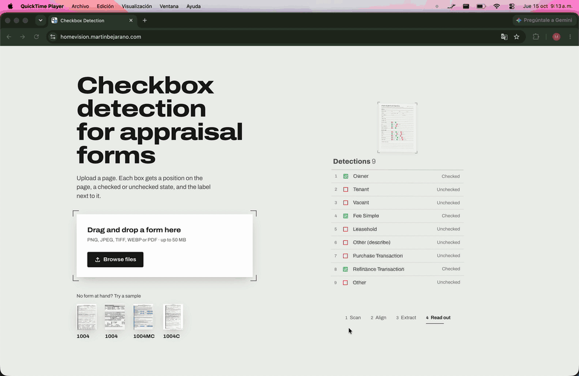
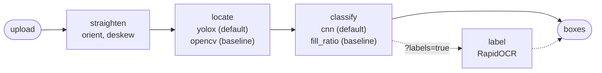

# checkbox-detection

Checkbox detection for scanned forms: finds the checkboxes on a document page, says whether each one is checked and, on request, reads the label printed next to it. Exposed as an HTTP API (`POST /detect`), with a demo page.

- Demo page: <https://homevision.martinbejarano.com>
- API: <https://homevision.martinbejarano.com/detect> (interactive docs at [`/docs`](https://homevision.martinbejarano.com/docs))



## Quick start

```sh
docker compose up
```

Open <http://localhost:8000> for the demo page; the API is on the same port. The image holds the API, the built frontend and the two fine-tuned models, so it needs nothing else.

### curl

```sh
curl -F file=@frontend/public/samples/sample-003.png http://localhost:8000/detect
```

```json
{"boxes": [
  {"bbox": [455, 397, 489, 430], "is_checked": true,  "page": 0, "score": 0.869},
  {"bbox": [590, 398, 621, 431], "is_checked": false, "page": 0, "score": 0.905},
  …
]}
```

With labels:

```sh
curl -F file=@frontend/public/samples/sample-003.png "http://localhost:8000/detect?labels=true"
```

```json
{"boxes": [
  {"bbox": [455, 397, 489, 430], "is_checked": true,  "page": 0, "score": 0.869, "label": "Owner"},
  {"bbox": [590, 398, 621, 431], "is_checked": false, "page": 0, "score": 0.905, "label": "Tenant"},
  …
]}
```

Swap `http://localhost:8000` for the demo URL to try the deployed instance.

### Demo page

Open the demo page (<https://homevision.martinbejarano.com>, or <http://localhost:8000>) and drop a form on it, or pick one of the four sample pages. Checked boxes are marked green, unchecked red, and low-confidence ones (`score` below 0.3) dashed orange; multi-page PDFs fill in page by page.

## How it works

Each page goes through four stages:



The default pipeline is **yolox + cnn**, chosen after evaluating every locator and classifier combination on the samples and on an external set (see [WRITEUP.md](WRITEUP.md)). `opencv` and `fill_ratio` are the classical baseline that came first, and can be selected with `CHECKBOX_LOCATOR=opencv CHECKBOX_CLASSIFIER=fill_ratio` when the model files are not available.

1. Straighten: turn the page upright and level, then map the boxes back to the original pixels (`detection/orient.py`, `detection/deskew.py`).
2. Locate: find the boxes (`detection/locate/`).
3. Classify: decide whether each box is checked (`detection/classify/`).
4. Label: read the text to the right of each box, only with `?labels=true` (`detection/label.py`).

`backend/src/checkbox_detection/detection/__init__.py` is the file to read first. `Pipeline.detect` calls the stages by name, so the order is visible in one place.

Locate and classify have two implementations each. `CHECKBOX_LOCATOR` / `CHECKBOX_CLASSIFIER` pick one, and `evaluate.py` compares every combination.

| Stage | Implementation | What it does |
| --- | --- | --- |
| Straighten | RapidOCR + projection profile | Uses the text lines RapidOCR finds to fix pages on their side or upside down, then levels tilts up to ±10° with a projection profile. |
| Locate | `opencv` | Classical baseline: binarize, erase table rules, keep hollow square-ish contours near the page's median box size. |
| Locate | `yolox` (default) | `nutrientdocs/form-field-v1-nano` (0.9M-parameter YOLOX-Nano, Apache-2.0), fine-tuned, run over overlapping tiles merged with NMS. |
| Classify | `fill_ratio` | Ink share inside the box; strokes that sit mostly outside it do not count. |
| Classify | `cnn` (default) | `nutrientdocs/form-field-v1-state` (96k-parameter CNN, Apache-2.0), fine-tuned, on gray crops with a third of a side of context, so a tick that spills out of the box is seen. |
| Label | RapidOCR | Recognition only (no text detection) on a strip cut right of each box. The strip ends at the next box on the row, a vertical rule, or a blank gap after the text. |

Why it is built this way:

- Locate and classify are separate, so each part is measured and swapped alone. A detector that also predicts the state has to be right about both at once, and you can't tell which half failed.
- The classical pipeline came first because it needs no data or weights, and every threshold can be read. It stays as the baseline, and can be selected with `CHECKBOX_LOCATOR=opencv CHECKBOX_CLASSIFIER=fill_ratio` when the model files are not available.
- The learned models are tiny ONNX files that run on onnxruntime, so the service needs no PyTorch at runtime.

### Tuning

The 4 original sample pages are too few to tune on, so every stage was tuned on public data: synthetic pages built from blank appraisal forms, five Roboflow checkbox datasets, and a validation set of 71 scanned housing-form pages (`backend/training/housing_val.py`) from the same public dataset as the external test set, which stays unseen. The samples and the external set are only used to evaluate; `scripts/evaluate.py --set NAME=DIR` scores any other folder in the ground-truth format. Known limits: labels are read only right of the box, round radio buttons are out of scope, and orientation costs about 1.2 s per page. All of it is covered in [WRITEUP.md](WRITEUP.md).

## API

### `POST /detect`

The request is `multipart/form-data` with one field, `file`. It accepts PNG, JPEG, TIFF (first frame only), WEBP and PDF. The format is read from the bytes; the `Content-Type` header and the filename are ignored.

The query parameter `labels` (bool, default `false`) adds a `label` to each box.

The response is `200` with `{"boxes": [...]}`, and an empty list when nothing is found. Each box has:

| Field | Meaning |
| --- | --- |
| `bbox` | `[x1, y1, x2, y2]`, integer pixels of the top-left and bottom-right corners, in the upright image (after EXIF rotation). For PDFs, the page rendered at 300 DPI. |
| `is_checked` | `true` for an intentional mark mostly inside the box (X, ✓, full or partial fill). A stray stroke crossing the box, a watermark or a colored cell fill is `false`. |
| `page` | 0-based page index; always `0` for images. |
| `score` | The locator's confidence that this is a checkbox, in [0, 1]. The OpenCV locator has none and always returns `1.0`. |
| `label` | Only with `?labels=true`. The text read right of the box, or `null` when nothing was read. |

Boxes come sorted by page, then top to bottom, then left to right.

`bbox` and `is_checked` are the original contract; `page`, `score` and `label` are extras a client can ignore.

### `POST /detect/stream`

The same request and boxes as `/detect`, as `application/x-ndjson`: one line per page, in page order, sent as soon as that page is done.

```json
{"page": 0, "boxes": [{"bbox": [455, 397, 489, 430], "is_checked": true, "page": 0, "score": 0.869}]}
{"page": 1, "boxes": []}
```

Every upload check runs before the first line, so a rejected upload gets the same problem+json error as `/detect`. A failure after the first line ends the stream with one `{"error": "..."}` line. The demo page uses this endpoint.

## Project structure

```
backend/
  src/checkbox_detection/
    api/          HTTP routes, schemas, errors
    detection/    the pipeline; start at __init__.py
    imaging/      decoding images and PDFs
  models/         fine-tuned ONNX models used by the service
  training/       offline tuning, its own uv project with PyTorch
  scripts/        evaluate.py
  tests/          tests, ground truth in tests/data/ground_truth/
  Dockerfile
frontend/         demo page (React, Vite, TypeScript)
  src/reader/     animated empty state, decoration only
samples/          pages used for evaluation
WRITEUP.md        how the design was reached, why yolox + cnn,
                  how it was evaluated, results,
                  limitations and next steps
```

## Development

Needs [uv](https://docs.astral.sh/uv/) and Node. From the zip distribution, `make test` first fetches the evaluation pages from this repository (`make samples`).

```sh
make install
make run            # API on :8000
make frontend-dev   # demo page on :5173, proxies to the API
make check          # lint, typecheck, tests, frontend build
```

## License

Apache-2.0 (`LICENSE`). The fine-tuned models under `backend/models/` derive from `nutrientdocs/form-field-v1-nano` and `form-field-v1-state`, both Apache-2.0; the training data is CC BY 4.0 (Roboflow) and public domain.
