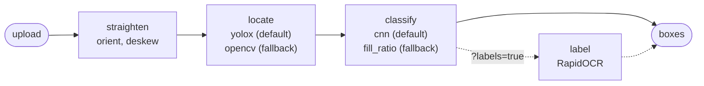

# checkbox-detection

An HTTP service that finds the checkboxes on a document page, says whether each one is checked and, on request, reads the label printed next to it.

- Demo page: <https://homevision.martinbejarano.com>
- API: <https://homevision.martinbejarano.com/detect> (interactive docs at [`/docs`](https://homevision.martinbejarano.com/docs))

## Quick start

### Docker

```sh
make docker-build
make docker-run
```

Open <http://localhost:8000> for the demo page. The image holds the API, the built frontend and the two fine-tuned models, so it needs nothing else.

### Local

Needs uv and Node.

```sh
make install
make models         # pretrained model files from Hugging Face
make run            # API on :8000
make frontend-dev   # demo page on :5173, in a second terminal
```

### curl

```sh
curl -F file=@samples/sample-003.png http://localhost:8000/detect
```

```json
{"boxes": [
  {"bbox": [455, 397, 489, 430], "is_checked": true,  "page": 0, "score": 0.869},
  {"bbox": [590, 398, 621, 431], "is_checked": false, "page": 0, "score": 0.905}
]}
```

With labels:

```sh
curl -F file=@samples/sample-003.png "http://localhost:8000/detect?labels=true"
```

```json
{"boxes": [
  {"bbox": [455, 397, 489, 430], "is_checked": true,  "page": 0, "score": 0.869, "label": "Owner"},
  {"bbox": [590, 398, 621, 431], "is_checked": false, "page": 0, "score": 0.905, "label": "Tenant"}
]}
```

Swap `http://localhost:8000` for the demo URL to try the deployed instance.

### Demo page

Open the demo page (<https://homevision.martinbejarano.com>, or port 8000 with Docker and 5173 locally) and drop a form on it, or pick one of the four sample pages under the drop target.

- Results: the page appears with a mark on every box: hatched green for checked, open red for unchecked, dashed orange for low confidence (`score` below 0.3). The Detections list fills on the right.
- Hover and click: hover a row and a leader line joins it to its box, the box is circled and its extent shows on the rulers. Hover a box and its row highlights. Click a row and the page scrolls to the box.
- Multi-page PDFs: each page's detections appear as soon as that page is read. The pager switches pages and the list follows.

## How it works

Each page goes through four stages:



The default pipeline is **yolox + cnn**, chosen after evaluating every locator and classifier combination on the samples and on an external set (see [WRITEUP.md](WRITEUP.md)). `opencv` and `fill_ratio` are the classical baseline that came first, kept as the fallback that needs no model files.

1. Straighten: turn the page upright and level, then map the boxes back to the original pixels (`detection/orient.py`, `detection/deskew.py`).
2. Locate: find the boxes (`detection/locate/`).
3. Classify: decide whether each box is checked (`detection/classify/`).
4. Label: read the text to the right of each box, only with `?labels=true` (`detection/label.py`).

`backend/src/checkbox_detection/detection/__init__.py` is the file to read first. `Pipeline.detect` calls the stages by name, so the order is visible in one place.

Locate and classify have two implementations each. `CHECKBOX_LOCATOR` / `CHECKBOX_CLASSIFIER` pick one, and `evaluate.py` compares every combination.

| Stage | Implementation | What it does |
| --- | --- | --- |
| Straighten | RapidOCR + projection profile | Uses the text lines RapidOCR finds to fix pages on their side or upside down, then levels tilts up to ±10° with a projection profile. |
| Locate | `opencv` | Classical baseline. Removes saturated color, binarizes, erases long table rules and keeps hollow, square-ish contours near the page's median box size, which drops glyphs like "O" and "D". |
| Locate | `yolox` (default) | `nutrientdocs/form-field-v1-nano`, a 0.9M-parameter YOLOX-Nano (Apache-2.0), fine-tuned. The page is cut into overlapping tiles whose size is a fraction of the page width, each tile runs through the model, and NMS merges the results. |
| Classify | `fill_ratio` | Ink share inside the box, after shrinking past the border. Strokes that sit mostly outside the box do not count, so a line crossing an empty box stays unchecked. |
| Classify | `cnn` (default) | `nutrientdocs/form-field-v1-state`, a 96k-parameter CNN on 40×160 gray crops (Apache-2.0), fine-tuned. All crops of a page go through one batched run. |
| Label | RapidOCR | Recognition only (no text detection) on a strip cut right of each box. The strip ends at the next box on the row, a vertical rule, or a blank gap after the text. |

Why it is built this way:

- Locate and classify are separate, so each part is measured and swapped alone. A detector that also predicts the state has to be right about both at once, and you can't tell which half failed.
- The classical pipeline came first because it needs no data or weights, and every threshold can be read. It stays as the baseline and as the fallback that runs without model files.
- The learned models are tiny ONNX files that run on onnxruntime, so the service needs no PyTorch at runtime.

### Tuning

The 4 original sample pages are too few to tune on, so every stage was tuned on public data and the samples are only used to evaluate.

- Training data: synthetic pages made from the official blank 1004, 1004C and 1004MC PDFs (boxes marked at random, rendered at 100 to 300 DPI and degraded like a scan) plus five CC BY 4.0 Roboflow checkbox datasets. 3,205 pages and 48,414 boxes for training, 610 pages and 10,426 boxes for validation. The split is by source form: the synthetic 1004C is the validation form.
- Models: `yolox` and `cnn` were fine-tuned from their published checkpoints and exported back to ONNX with the same inputs and outputs, so only the model file changed.
- Parameters: the `*Params` of every stage were chosen by search on validation. A value only moved when it gained at least half a point.
- Isolation: `training/` is its own uv project with PyTorch. The service never imports it, and it never reads the samples or the external set.

## API

### `POST /detect`

The request is `multipart/form-data` with one field, `file`. It accepts PNG, JPEG, TIFF (first frame only), WEBP and PDF. The format is read from the bytes; the `Content-Type` header and the filename are ignored.

The query parameter `labels` (bool, default `false`) adds a `label` to each box.

The response is `200` with `{"boxes": [...]}`, and an empty list when nothing is found. Each box has:

| Field | Meaning |
| --- | --- |
| `bbox` | `[x1, y1, x2, y2]`, integer pixels of the top-left and bottom-right corners, in the upright image (after EXIF rotation). For PDFs, the page rendered at 300 DPI. |
| `is_checked` | `true` for an intentional mark mostly inside the box (X, ✓, full or partial fill). A stray stroke crossing the box, a watermark or a colored cell fill is `false`. |
| `page` | 0-based page index; always `0` for images. |
| `score` | The locator's confidence that this is a checkbox, in [0, 1]. The OpenCV locator has none and always returns `1.0`. |
| `label` | Only with `?labels=true`. The text read right of the box, or `null` when nothing was read. |

Boxes come sorted by page, then top to bottom, then left to right.

`bbox` and `is_checked` are the original contract; `page`, `score` and `label` are extras a client can ignore.

### `POST /detect/stream`

The same request and boxes as `/detect`, as `application/x-ndjson`: one line per page, in page order, sent as soon as that page is done.

```json
{"page": 0, "boxes": [{"bbox": [455, 397, 489, 430], "is_checked": true, "page": 0, "score": 0.869}]}
{"page": 1, "boxes": []}
```

Every upload check runs before the first line, so a rejected upload gets the same problem+json error as `/detect`. A failure after the first line ends the stream with one `{"error": "..."}` line. The demo page uses this endpoint.

### Settings

Environment variables with the prefix `CHECKBOX_`. The defaults need none.

| Variable | Default |
| --- | --- |
| `CHECKBOX_LOCATOR` | `yolox` (or `opencv`, which needs no model file) |
| `CHECKBOX_CLASSIFIER` | `cnn` (or `fill_ratio`, which needs no model file) |
| `CHECKBOX_MODELS_DIR` | `models`, relative to `backend/` |
| `CHECKBOX_ONNX_THREADS`, `CHECKBOX_CV_THREADS` | 1 each; scale with uvicorn workers instead |
| `CHECKBOX_MAX_UPLOAD_BYTES` | 50 MiB |
| `CHECKBOX_MAX_PDF_PAGES` | 100 |
| `CHECKBOX_MAX_IMAGE_PIXELS` | 50,000,000 |
| `CHECKBOX_PDF_DPI` | 300 |
| `CHECKBOX_LOG_LEVEL` | `INFO` |
| `CHECKBOX_STATIC_DIR` | unset; the Docker image sets it to serve the demo page at `/` |

## Repository

- `backend/`: the service (`src/`), offline tuning (`training/`), `scripts/evaluate.py`, tests and the Dockerfile.
- `frontend/`: the demo page (React, Vite, TypeScript). `src/reader/` is the animated empty state; it is decoration and nothing else depends on it.
- `samples/`: the pages used for evaluation, with ground truth in `backend/tests/data/ground_truth/`.
